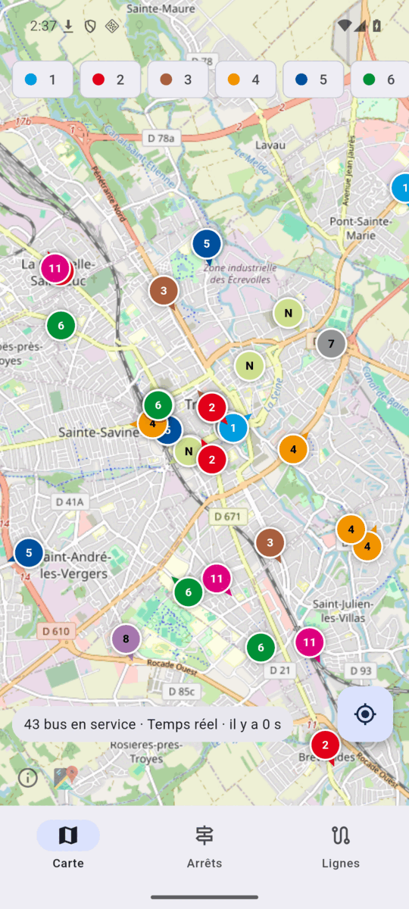
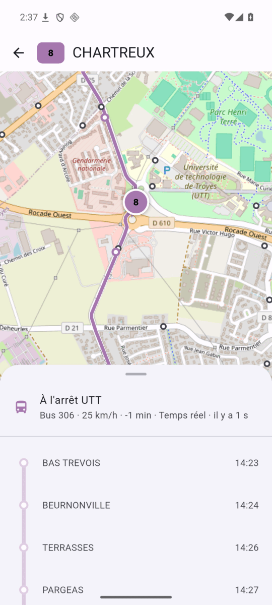
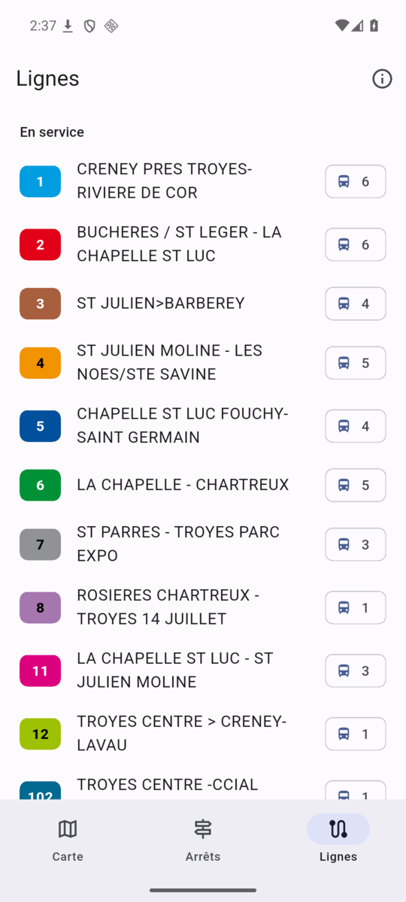

# Re-TCAT

[English](README.md) · **Français**

Les bus [TCAT](https://www.tcat.fr/) de Troyes en temps réel, sur Android et iPhone. Libre et open source, sans
compte, sans publicité, sans traqueur.

<p>
  
  
  
  
  
</p>

## Fonctionnalités

- **Carte** : tous les bus en service, à la couleur de leur ligne, avec leur direction. Filtre par ligne.
- **Suivre un bus** : la carte le suit et ses arrêts affichent l'heure de passage prévue, le retard, les arrêts non
  desservis.
- **Arrêts** : recherche, arrêts autour de vous, favoris avec leurs prochains bus (en direct quand le bus est suivi,
  horaire théorique sinon).
- **Lignes** : tracé, arrêts dans chaque sens, bus en service, perturbations.
- **Widget** : les prochains bus d'un arrêt sur l'écran d'accueil (Android et iOS).

## Installation

**Android** (8.0 ou plus) : depuis [mon dépôt F-Droid](https://eylexander.github.io/fdroid/) (à ajouter dans F-Droid,
Droid-ify ou Neo Store pour les mises à jour), ou l'APK des [releases](https://github.com/Eylexander/re-tcat/releases).

**iPhone** : pas de version App Store. Prenez l'`.ipa` des [releases](https://github.com/Eylexander/re-tcat/releases)
et installez-le avec un outil qui le signe avec votre identifiant Apple : [xtool](https://github.com/xtool-org/xtool)
(même depuis Linux : `xtool install re-tcat-vX-unsigned.ipa`), AltStore, SideStore ou Sideloadly. Le widget a besoin
d'un compte développeur Apple payant (App Groups) ; l'application, non.

## Fonctionnement

Mêmes données et mêmes règles que [ha-tcat](https://github.com/Eylexander/ha-tcat), son équivalent pour Home
Assistant :

- **Horaires** : le GTFS de TCAT sur
  [transport.data.gouv.fr](https://transport.data.gouv.fr/datasets/donnees-tcat-troyes-champagne-metropole-1). Chaque
  fichier n'est valable que quelques semaines : l'application le télécharge (2,5 Mo) au premier lancement, puis à
  chaque nouvelle publication de TCAT, au lieu de l'embarquer.
- **Temps réel** : les flux GTFS-RT de TCAT (positions des bus, prévisions de passage, perturbations), interrogés
  toutes les 15 secondes quand l'application est ouverte.

L'application interroge directement ces flux publics. Aucun serveur intermédiaire, rien n'est envoyé sur vous. La
position est facultative, utilisée seulement à la demande pour « Arrêts autour de moi », et reste sur le téléphone.

## Compiler

Il faut [Flutter](https://docs.flutter.dev/get-started/install) 3.47 (Dart 3.13).

```sh
flutter pub get
flutter test
flutter run                                                  # sur un téléphone branché ou un émulateur
flutter build apk --release --target-platform android-arm64 # build/app/outputs/flutter-apk/app-release.apk
```

Les builds de debug s'installent à côté de l'application (`com.eylexander.retcat.debug`, « Re-TCAT (dev) »). iOS se
compile sur macOS : le workflow de release produit l'`.ipa` sur GitHub Actions. [CLAUDE.md](CLAUDE.md) détaille
l'architecture, les particularités des données et les releases (en anglais).

## Contribuer

Signalements de bugs et pull requests bienvenus. Lancez `flutter analyze`, `flutter test` et
`dart format -l 120 lib test` avant d'envoyer une modification. Pour un retard faux ou un bus absent, indiquez
l'arrêt, la ligne et l'heure : le flux temps réel de TCAT a ses bizarreries, et c'est ce qu'il faut pour les
reproduire.

## Licence

Code sous licence [MIT](LICENSE).

Données : TCAT / Troyes Champagne Métropole, sous licence
[ODbL](https://opendatacommons.org/licenses/odbl/). Carte : © les contributeurs
d'[OpenStreetMap](https://www.openstreetmap.org/copyright).

Application non officielle, sans lien avec TCAT ni Troyes Champagne Métropole.
